# 8-bit ALU (Verilog) – from RTL to Logic Synthesis (Cadence Genus, 45 nm)

An 8-bit combinational ALU written in Verilog, with an arithmetic unit, a logic/compare unit, a simulation testbench, and the complete synthesis results (netlists, SDC, timing/power/area reports).

<p align="center">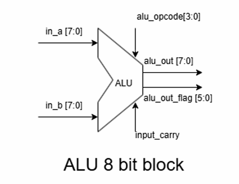</p>

## Repository structure

```
rtl/                     Design source code
  ALU.v                  Top module (selects arithmetic / logic unit, generates flags)
  arith_unit.v           ADD, SUB, MUL, INC, DEC, shift left/right
                         (+ full adder, subtractor, multiplier, shifter)
  logic_unit.v           COMPARE, AND, OR, XOR, NOT A, NOT B (+ 8-bit comparator)
tb/
  tb_ALU.v               Testbench ($monitor + VCD dump)
  run_sim.sh             Run simulation (xrun or iverilog)
docs/images/             Block diagrams, schematics, waveforms, reports (used in this README)
synthesis/
  sdc/ALU_sdc.sdc        Timing constraints
  scripts/alu_synth.tcl  Genus synthesis flow
  outputs/               Generic & mapped netlists (.v) + SDC
  reports/               timing, power, area, check_design, timing_lint
```

## Interface

| Port | Width | Description |
|---|---|---|
| `in_a`, `in_b` | WIDTH (default 8) | Operands |
| `input_carry` | 1 | Carry/borrow in (also the bit shifted in for shift operations) |
| `alu_opcode` | 4 | Operation code (see table below) |
| `alu_out` | WIDTH | Result |
| `alu_out_flag` | 5 | `[0]` zero, `[1]` A>B, `[2]` A=B, `[3]` A<B, `[4]` carry/overflow |

## Opcode table

`alu_opcode[3]` = 0 → arithmetic unit, = 1 → logic unit.

| Opcode | Operation | Notes |
|---|---|---|
| `0000` | ADD | `A + B + cin`, flag [4] = carry out |
| `0001` | SUB | `A − B − bin` |
| `0010` | MUL | 4×4-bit multiply (uses `A[3:0]`, `B[3:0]`), flag [4] = overflow (result wider than 4 bits) |
| `0011` | INC | `A + 1 + cin` |
| `0100` | DEC | `A − 1 − bin` |
| `0101` | SHL | Shift left, shifted-in bit = `input_carry`, flag [4] = MSB shifted out |
| `0110` | SHR | Shift right, shifted-in bit = `input_carry`, flag [4] = LSB shifted out |
| `1000` | COMPARE | `alu_out = 1` if A = B; GT/EQ/LT flags are always updated |
| `1001` | AND | `A & B` |
| `1010` | OR | `A \| B` |
| `1011` | XOR | `A ^ B` |
| `1100` | NOT A | `~A` |
| `1101` | NOT B | `~B` |

## Architecture

Top-level view: `alu_opcode[3]` selects between the arithmetic and logic units; `alu_opcode[2:0]` selects the operation inside the chosen unit.

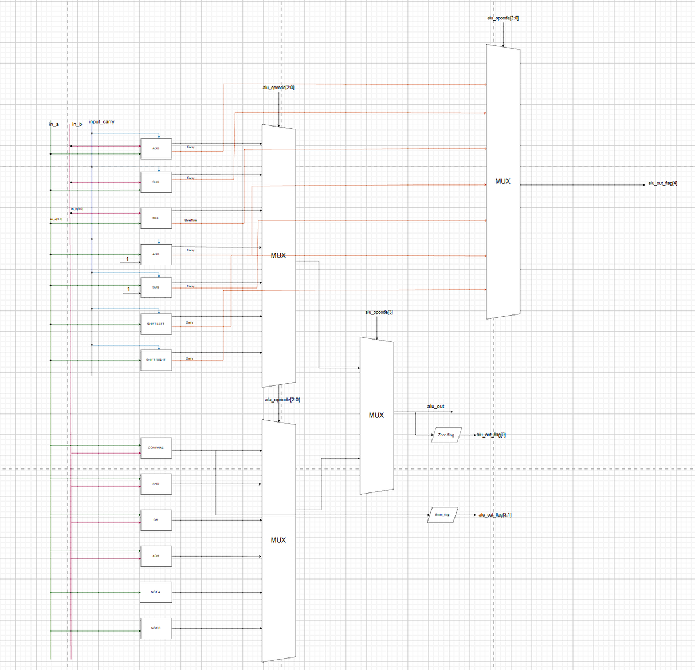

**Arithmetic unit** (ADD, SUB, MUL, INC, DEC, SHL/SHR) and **logic unit** (COMPARE, AND, OR, XOR, NOT A, NOT B):

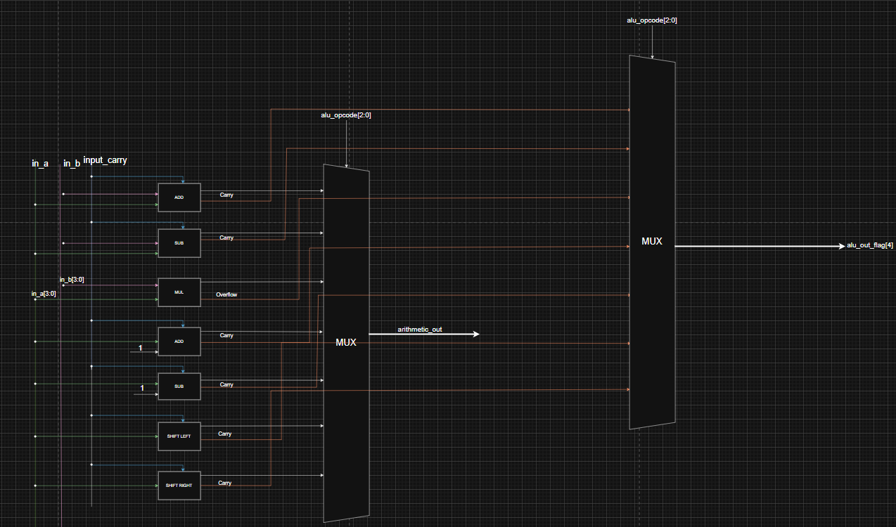
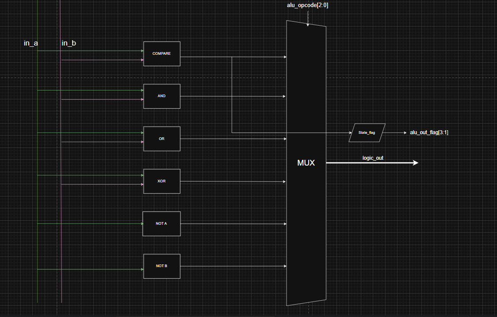

### Low-level blocks

| 8-bit ripple-carry adder | 8-bit ripple-borrow subtractor |
|---|---|
| 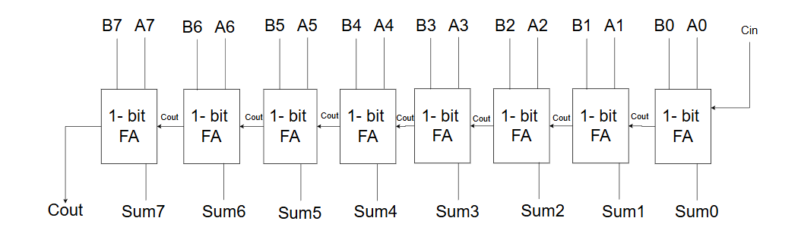 | 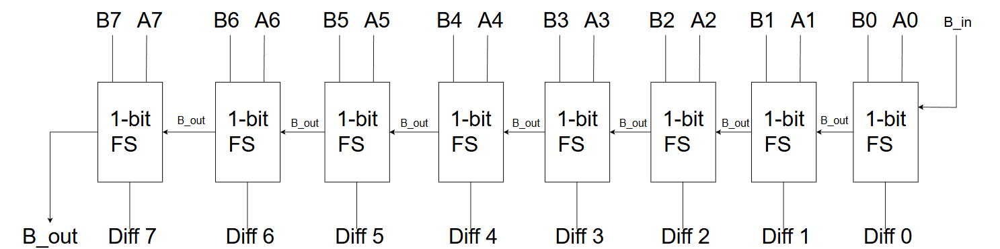 |

**4×4 array multiplier:**

<p align="center">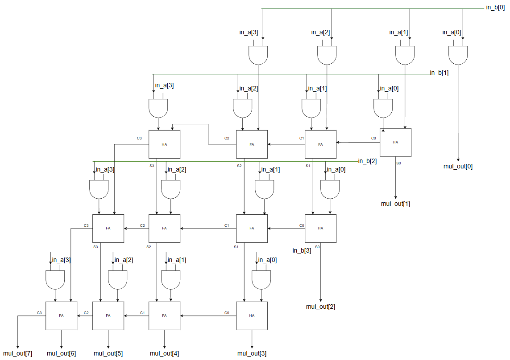</p>

**8-bit comparator** (a chain of eight 1-bit comparators producing the GT/EQ/LT flags):

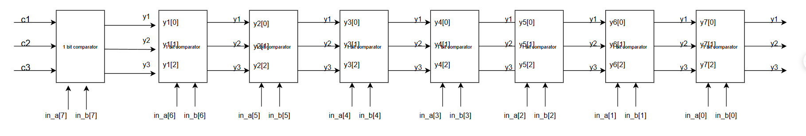

## Simulation results

Reference waveform (ADD, SUB, MUL, INC, DEC, SHL, SHR, COMPARE):

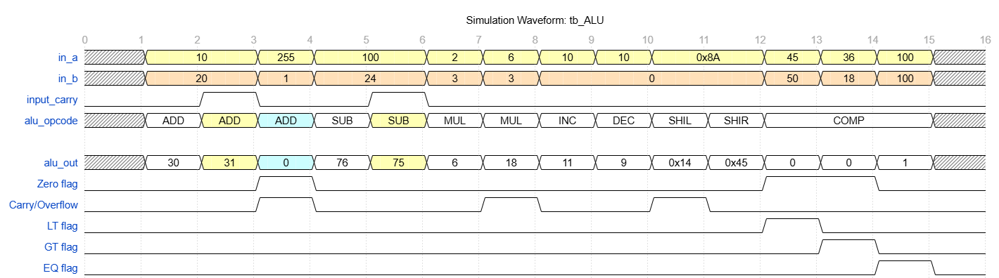

Actual simulation waveform from `tb_ALU.v`:

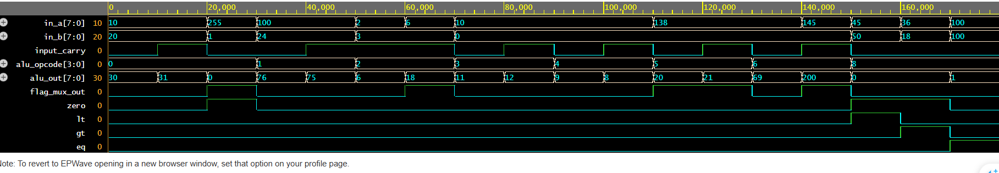

## Running the simulation

```bash
./tb/run_sim.sh
# or Cadence:  xrun rtl/ALU.v tb/tb_ALU.v -access +rwc -64bit
# or Icarus :  iverilog -g2005 -o sim.out rtl/ALU.v tb/tb_ALU.v && vvp sim.out
```
The waveform is written to `dump.vcd` (view it with GTKWave/SimVision).

## Synthesis results (Genus 21.12, PVT_1P32V_0C)

| Metric | Value |
|---|---|
| Cell count | 338 |
| Area | 517.788 µm² |
| Total power | ≈ 247.6 µW (leakage 45 nW, internal 141.5 µW, switching 106 µW) |
| Constraints | Virtual clock 0.5 ns, input/output delay 0.1 ns |
| Timing (in→out) | MET, slack +22 ps (critical path `in_b[0]` → `alu_out_flag[4]`) |

<details><summary>Timing and power reports (images)</summary>

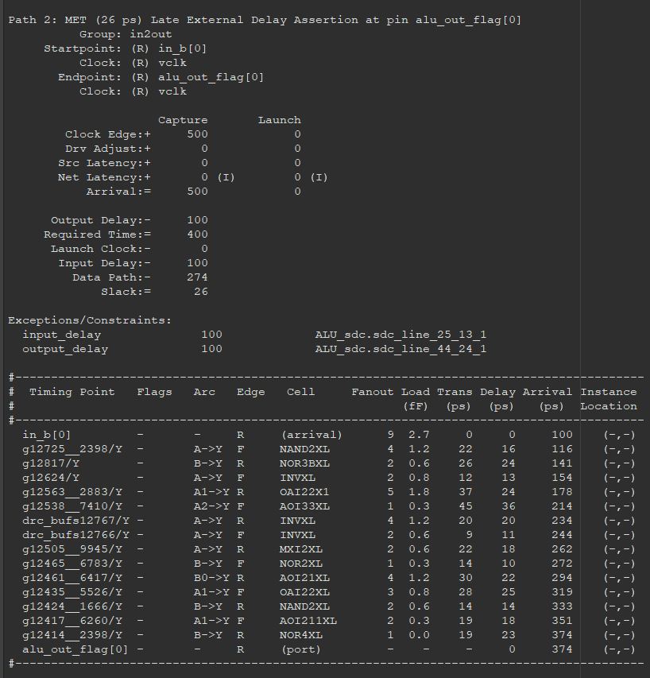
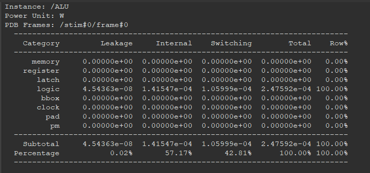

</details>

To re-run synthesis: provide the `.lib` technology libraries (not included in this repo), then run `cd synthesis && genus -f scripts/alu_synth.tcl`.

## Known issues / possible improvements

- `fadder_8bit` and `fsubtrator_8bit` have a trailing comma at the end of the port list (`output cout,`) – strict Verilog compilers will report an error.
- The INC/DEC carry flag [4] is taken from the ADD/SUB units (`add_cf`/`sub_cf`) instead of `inc_cf`/`dec_cf`, so it may be wrong.
- INC/DEC also add/subtract `input_carry` (e.g. 10+1+1 = 12), while the testbench comment expects 11.
- The testbench is not self-checking – it only prints results for visual inspection.
- The adder is ripple-carry; a carry-lookahead adder could improve timing.

## Tools

Cadence Genus 21.12 (synthesis), Cadence Xcelium 22.03 (simulation), GPDK045 / OSU FreePDK 45 nm libraries.
